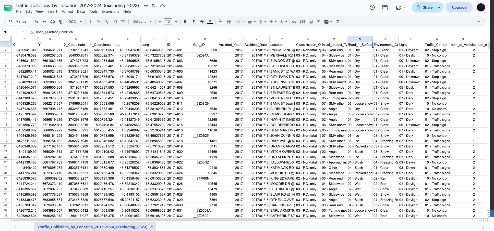
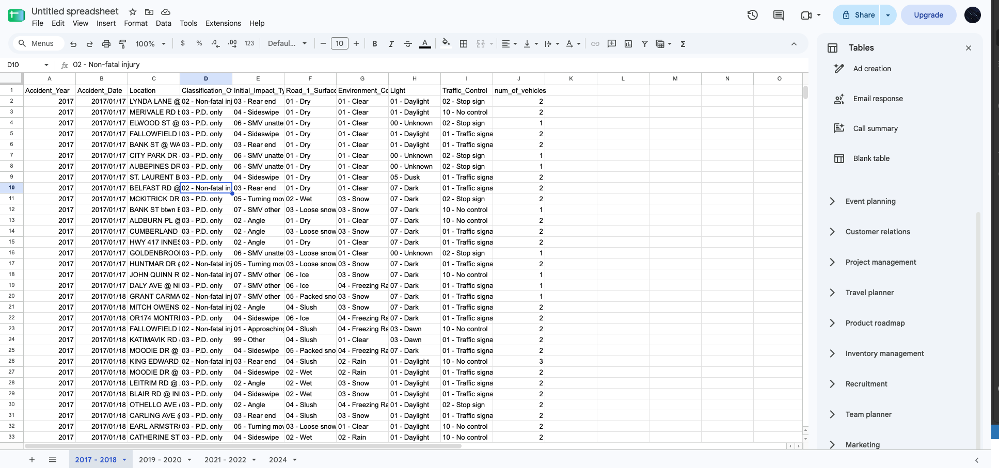
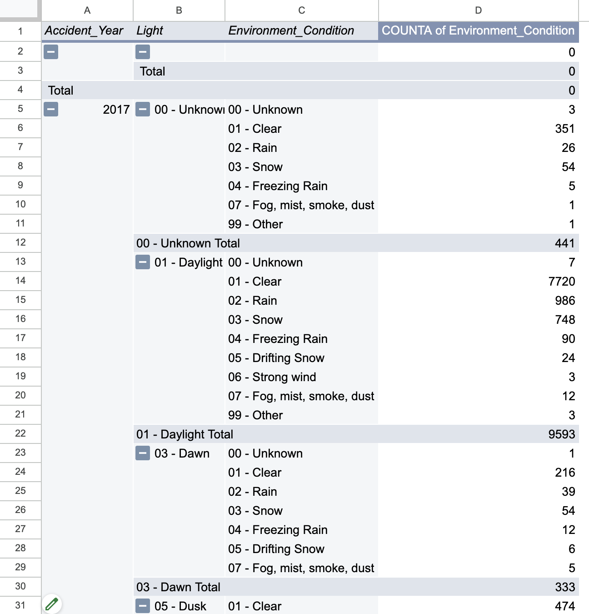
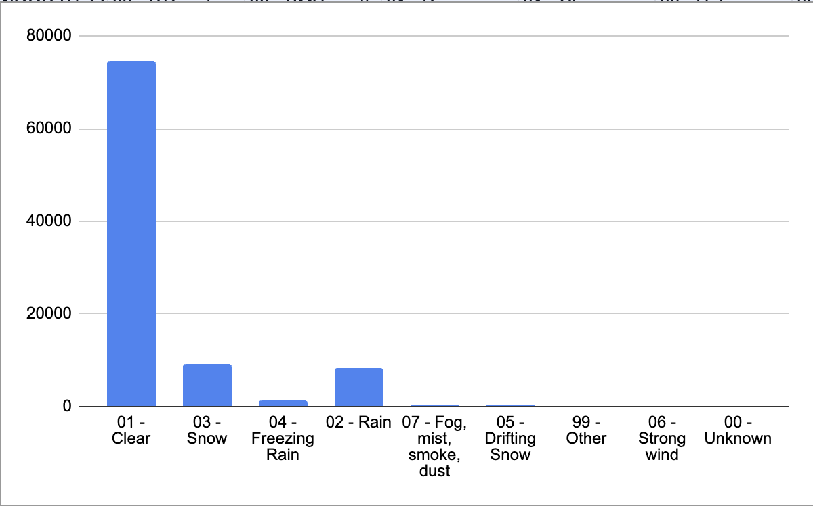

**5 November 2026** 
**MPAD 2003 Data Storytelling** 
**Luwi Kabaso** 
**Presented to Jean-Sébastien Marier** 

# Deliverable 2: Exploratory Data Analysis (EDA)

## 1. Getting Data

For this assignemnt I will be analyzing the dataset on traffic colliosns from open ottawa to see what role road and weather conditions played in the cause of the collision and if any pattern can be derived from this. Originally I planned on using `IMPORTDATA` to extract the data from the dataset however I would soon find out that would be impossible to do on open ottawa so I resorted to doing it manually by downloading the csv and importing it from file. (https://docs.google.com/spreadsheets/d/1PMjr_dMFUb8QtXqLGrBA_43ulSd87OVDIKUuzPKIOYg/edit?usp=sharing) 

 
*Figure 1: The imported data.*

Once i did that I selected the rows with the data I needed only as there were originally 17 columns but I only needed atleast 8 such as column N which had ordinal vairables on the conditions of the road, column R which had quantitive ratio variables on the number of cars involved and column L also with ordinal variables. but covering the classification of the accidents. There were also over a thousand rows as the data ranged from the years 2017 to 2024 (excluding 2023) so I decided to create seperate sheets for each of the years, i.e 2017 - 2018,  2019 - 2020 and so on. (https://docs.google.com/spreadsheets/d/1a3oO_SJUtO0-cOCRndJqsE5OG9lnO--kZDpro2BcLkY/edit?usp=sharing)

 
*Figure 1: The data imported into seperate sheets*

I created these sheets in a seperate file and planned on using `IMPORTRANGE` to put get the desired columns and rows in there. However before I could do that I had to make sure the rows were ordered correctly else it would be a mess upon importation. After reviewing it all I saw that some of the years were mixed together and were not properly in accending order so by using the advanced range sorting options I ordered it correctly. I also used the data cleanup tool to get rid of white spaces as well. After all that I imported the data as planned

## 2. Understanding Data

### 2.1. VIMO Analysis

For the VIMO analysis I used openrefine as suggested on both the original spreadsheet and the latter one. I did both as the file for the latter spreadsheet only featured one of the sheets so to make sure all the data was clean I used the original one. I then used the text facet to analyze three columns, those columns being "Road_1_Surface_Condition" covering the conditions of the road, "Environment_Condition" covering the weather condition, and "Light" which covers how bright it was outside. Using the text facet and cluster tool  I could find that all the variables were valid, though there was a variable in all 3 columns called "unknown" that to my understanding shows that some data is missing or just as it says unknown. 

When looking for outliers I noticed in the column for the road conditions that the outliers there were dry, spilled liquid, mud, sand or loose gravel, wet and other. Most of the variables in this category are in the thousands while the majority of the mentioned outliers are in the 10s or 100s, though one with the most dramatic distance from the rest of the variables (being 50k greater than the second greatest outlier) is Dry.

For Environment_Condition again most of the variables are in the thousands with few outliers in the 10s and 100s but this time only one outlier in the ten thousands being clear weather which is at 70k.

For Light once more the majority is in the thousands with again an outlier in the 10s being Other at 41 but once more here there is a dramatic outlier existing at 60k being Daylight.

### 2.2. Cleaning Data

 In the previous step I had already cleaned all the white spaces in google sheets so I did not have to worry about that here. By using the text facet I checked for any duplicates or typos in all the columns and found none. From what I could find the dataset was for the most part already clean.

### 2.3. Analyzing Data

For the pivot table I used the variables from Light and environment conditions to showcase the frequency of collisions throughout the day under certain environmental conditions. After observing the pivot table I noticed the pattern of collisions occuring the most consistently throughout the times and years under clear environmental conditions. I noticed a similar pattern in the Stacked column chart I made which looked at the environmental conditions throughout the years. By a long shot most of them occurred when it was clear.

I also made pie charts in the other spreadsheet with the years separated. In each sheet I made 3 to represent collisions that occurred under certain environmental conditions, the conditions of the road when they occurred, and the time they occurred. From observing all the charts it can be seen that the majority of collisions occur when the weather is clear, the road is dry and during the day.

There are many possible stories that can be told from this, one of the most obvious ones being on why more traffic collisions occur during clear weather and on dry roads than other conditions that on the surface should cause more collisions. This story can explore the reason behind the huge outliers that exist in this dataset. 

Though while looking at the charts something that I thought of that should also be investigated and taken into account is how many people drive during other weather conditions that are seemingly unideal to drive in. While there is a fairly clear correlation of collisions and clear weather conditions this dataset only counts reported collisions in Ottawa and the conditions of them so can naturally be limited in determining the cause and which conditions are more dangerous than others.

 
*Figure 2: This pivot table shows the amount of collisions that took place under certain environmental conditions throughout the years*

 
*Figure 3: This exploratory chart shows the total amount of collisions that has taken place under certain environmental conditions*

## 3. Delivering Data

In terms of who I could interview for this, I could interview anyone with experience driving through different environmental conditions, people in the Ottawa Safety Council or any other road safety experts in other organizations.

After doing some research on the story idea I found an article by capitalcurrent from 2025 about a councilor calling for the city to fix "Ottawa’s most accident-prone intersection". Further down in the article it is reported that most collisions occur during clear weather than other weather conditions. Though here it is presented that the cause of these collisions are how the intersections are designed. In this article Carleton University Chair of Department of Civil and Environmental Engineering comments that intersection design can make people drive erratically because turning right is easy, but turning left is more difficult. 

Another article found on capital current titled "No matter the weather, the City of Ottawa urges vigilance behind the wheel to limit collisions" the data presented has similar results to my analysis however they also look into which seasons of the year they occur in the most as well and not just the specific conditions. From this they have observed that colder seasons face more collisions than warmer ones. In light of these findings the article urges citizens to act cautiously on the road and to practice risk reduction behaviours.

## 4. References

Include a list of your references here. Please follow [APA](https://apastyle.apa.org/style-grammar-guidelines/references) or [MLA](https://www.mla.org/MLA-Style) guidelines for references. Hanging paragraphs aren't required though.

Ryan Clark, Tessa Peterson. “No Matter the Weather, the City of Ottawa Urges Vigilance behind the Wheel to Limit Collisions.” Capital Current, 20 Mar. 2025, capitalcurrent.ca/no-matter-the-weather-the-city-of-ottawa-urges-vigilance-behind-the-wheel-to-limit-collisions/. 

Garwolinski, Matthew. “Councillor Calls on City to Fix Ottawa’s Most Accident-Prone Intersection.” Capital Current, 14 Apr. 2025, capitalcurrent.ca/councillor-calls-on-city-to-fix-ottawas-most-dangerous-intersection/. 

Government of Canada, Statistics Canada. “Data Accuracy and Validation: Methods to Ensure the Quality of Data.” Government of Canada, Statistics Canada, 2 Nov. 2026, www.statcan.gc.ca/en/wtc/data-literacy/catalogue/892000062020008. 

Government of Canada, Statistics Canada. “Statistics: Power from Data! 4 Data Exploration.” Data Exploration, 2 Sept. 2021, www150.statcan.gc.ca/n1/edu/power-pouvoir/ch8/5214810-eng.htm. 

